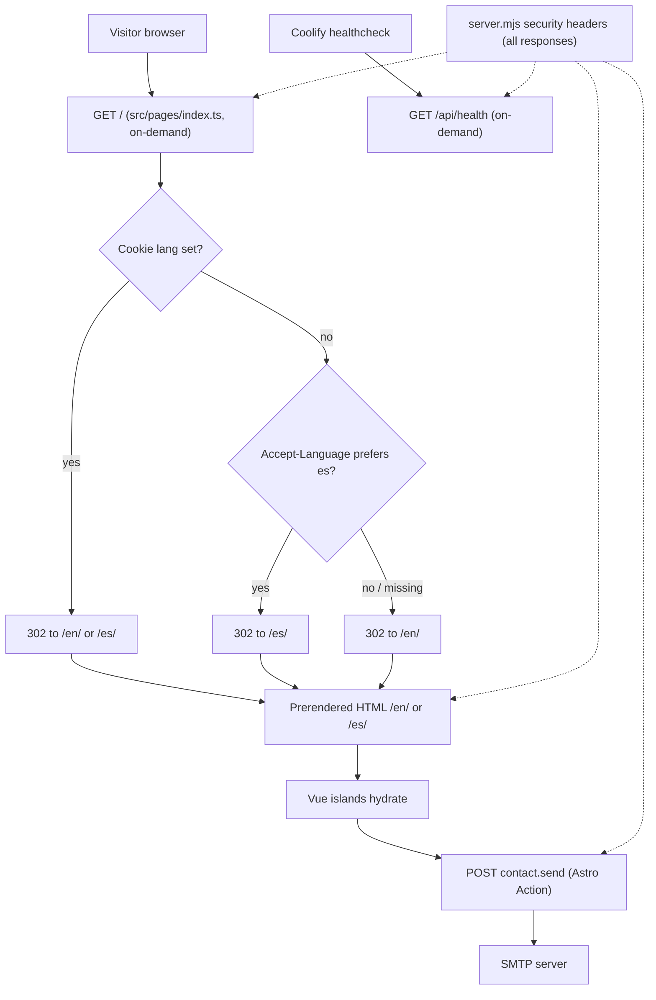

# Godixy Technologies landing page

Bilingual (EN/ES) corporate site for Godixy Technologies. Most pages are prerendered HTML. A Node process serves the locale redirect, the contact Astro Action, security headers, and a health endpoint.

**Spanish handover (operators):** [`docs/gdf/06-handover/indice.md`](docs/gdf/06-handover/indice.md)

G7 acceptance, G8 production, and G9 closure are **not approved**. This README describes the repository as implemented, not a live production sign-off.

Intended public origin (canonical / hreflang): `https://godixy.com`.

## Quick path

1. Install Node.js **22.12.0 or newer** (`package.json` `engines.node`).
2. `npm ci`
3. Copy `.env.example` to `.env` if you need local SMTP or a non-default `SITE_URL`.
4. `npm run dev` — Astro dev server.
5. After `npm run build`, `npm run preview` (or `npm start`) runs `node ./server.mjs`.

## Architecture

Astro `output: 'static'` plus `@astrojs/node` (`mode: 'standalone'`). `server.mjs` imports `dist/server/entry.mjs` with autostart disabled and adds headers that Astro middleware would not apply to prerendered files.

Vue 3 islands hydrate only where the page needs client behaviour. Copy lives in typed dictionaries, not in components. The only outbound integration is SMTP for the contact form. There is no database, login, or CMS.

### Request flow

Matches [`docs/gdf/03-design/architecture.md`](docs/gdf/03-design/architecture.md):



`/` is on-demand (`prerender = false`). Locale pages are prerendered via `getStaticPaths` for `en` and `es`. Astro i18n: `locales: ['en','es']`, `defaultLocale: 'en'`, `prefixDefaultLocale: true`, `redirectToDefaultLocale: false` (root redirect is owned by `src/pages/index.ts`).

`server.mjs` sets `X-Content-Type-Options`, `X-Frame-Options: DENY`, `Referrer-Policy`, `Permissions-Policy`, `Cross-Origin-Opener-Policy`, and `Content-Security-Policy: frame-ancestors 'none'`. It adds `Strict-Transport-Security` only when `ENABLE_HSTS=true`.

### Feature folders

```text
src/
├── pages/            index.ts (redirect), [lang]/index.astro, [lang]/privacy.astro, 404.astro, api/health.ts
├── layouts/          BaseLayout.astro (head, SEO, hreflang, lang attr)
├── actions/index.ts  registers contact.send (same-origin check, IP key, error mapping)
├── features/
│   ├── hero/ services/ process/ audience/ about/ engagement/ faq/ navigation/
│   └── contact/      ContactForm.vue, schema.ts (Zod, shared client/server)
└── shared/
    ├── i18n/         en.ts, es.ts (typed against en), utils.ts
    ├── ui/           presentational primitives
    ├── motion/       lazy loaders + reduced-motion helpers
    └── styles/       tokens, global CSS
```

Rules (from the architecture note):

- `features/*` may import `shared/*`. Features do not import each other except `services` → `contact/service-intent.ts` (preselects a service in the form).
- Islands receive translated strings as props. Dictionaries are not shipped whole to the client.
- Only `actions/`, `pages/index.ts`, and `pages/api/*` run on the server at request time. `server.mjs` is the process entry point.

## Prerequisites

| Item | Requirement |
| --- | --- |
| Node.js | `>=22.12.0` |
| Package manager | npm (lockfile: `package-lock.json`; `Dockerfile` runs `npm ci`) |
| Build | `npm run build` before `preview` / `start` |
| SMTP | Optional for local UI. Required in production if the Action must deliver mail |

## Scripts

From `package.json`:

| Script | Command | What it does |
| --- | --- | --- |
| `dev` | `astro dev` | Local development |
| `build` | `astro build` | Prerender locales and emit the Node handler under `dist/` |
| `preview` | `node ./server.mjs` | Production entry (needs a prior build) |
| `start` | `node ./server.mjs` | Same as preview |
| `check` | `astro check && vue-tsc --noEmit -p tsconfig.json` | Types and Astro/Vue diagnostics |
| `lint` | `eslint .` | Lint |
| `test` | `vitest run` | Unit tests |
| `test:e2e` | `playwright test` | End-to-end tests |
| `verify` | `npm run check && npm run lint && npm run test && npm run build` | Local quality gate |

`npm run format` (`prettier --write .`) is also available.

## i18n

Supported locales: `en`, `es`. Default: `en`. Cookie name: `lang`.

**`GET /` negotiation** (`src/pages/index.ts` → `resolvePreferredLang`):

1. Cookie `lang` if it is `en` or `es`.
2. Else `Accept-Language` (q-values; first supported base tag).
3. Else English.

The 302 sets `Location: /en/` or `/es/`, `Vary: Accept-Language, Cookie`, and `Cache-Control: private, no-store`.

The language switcher (`LanguageSwitcher.vue`) writes `lang` for one year (`SameSite=Lax`; `Secure` on HTTPS) and navigates to the other locale, keeping the section currently in view when that section has an `id`.

### How to edit copy

1. Change English in [`src/shared/i18n/en.ts`](src/shared/i18n/en.ts). That file defines the `Dictionary` type.
2. Change Spanish in [`src/shared/i18n/es.ts`](src/shared/i18n/es.ts). It is typed as `Dictionary`, so missing or extra keys fail `npm run check`.
3. Do not put visitor-facing strings in `.astro` / `.vue` files. Pass `t` (or a slice of it) from the page.
4. Shared codes (company sizes, service ids) live in [`src/shared/i18n/config.ts`](src/shared/i18n/config.ts). Labels stay in the dictionaries.

Operator steps: [`docs/gdf/06-handover/editar-contenido.md`](docs/gdf/06-handover/editar-contenido.md).

## Contact form

- Client: `ContactForm.vue` (`client:visible`), Zod schema in `src/features/contact/schema.ts`.
- Server: Astro Action `contact.send` (`accept: 'json'`) in `src/actions/index.ts`.
- Mail: nodemailer via `getMailSender()` in `src/features/contact/server/mailer.ts`.
- Recipient default: `hello@godixy.com` (`CONTACT_TO`).
- Anti-abuse: hidden honeypot (`website`) — filled bots get a success response and no email; in-memory rate limit **5 requests / 10 minutes** per IP.
- Behind a reverse proxy set `TRUST_PROXY` so the first `X-Forwarded-For` hop is the rate-limit key.

Env names (see `.env.example` and `astro.config.mjs`; never commit values):

| Name | Role |
| --- | --- |
| `SMTP_HOST` | If empty, no transporter is created |
| `SMTP_PORT` | Default `587` |
| `SMTP_SECURE` | Default `false` |
| `SMTP_USER` / `SMTP_PASS` | Optional auth |
| `CONTACT_TO` | Inbox |
| `CONTACT_FROM` | Envelope From |
| `HOST` / `PORT` | `server.mjs` listen (`0.0.0.0` / `4321`) |
| `SITE_URL` | Canonical / hreflang origin (read at **build** time) |
| `TRUST_PROXY` | Rate-limit IP behind a proxy |
| `ENABLE_HSTS` | HSTS header only when the string is `true` |

**When `SMTP_HOST` is unset**

- Production (`NODE_ENV` / non-dev Action): the Action returns mail unavailable. The form shows the localized failure and a `mailto:` link (`buildMailto` in `src/features/contact/mailto.ts`) to `hello@godixy.com`.
- `astro dev`: the handler logs the payload and returns success so local UI work is not blocked. No message is sent.

## Brand tokens

Implemented in [`src/shared/styles/tokens.css`](src/shared/styles/tokens.css) from the Godixy style guide (navy, teal, Inter, 4–64 px spacing, radii 8 / 12 / 16 / pill):

| Token | Value | Use |
| --- | --- | --- |
| `--color-navy` | `#101e38` | Headings, primary button, footer |
| `--color-teal` | `#4eacc4` | Decorative accent (not body text on white) |
| `--color-teal-text` | `#1a7088` | Text-safe teal (contrast on white / surface) |
| `--color-soft-teal` | `#e2f4f6` | Tinted surfaces |
| `--color-surface` | `#f5f7fa` | Section backgrounds |
| `--font-sans` | Inter Variable / Inter | UI type |
| `--space-1` … `--space-8` | 4px … 64px | Spacing scale |
| `--radius-card` / `--radius-panel` / `--radius-lg` | 8 / 12 / 16 px | Cards and panels |

## Deploy

Operational steps, env names, healthcheck, and rollback: [`docs/gdf/05-release/deploy-runbook.md`](docs/gdf/05-release/deploy-runbook.md) (Paula Castillo). That runbook does not approve G8 and does not authorize a production deploy.

Local production-like process after a build:

```bash
npm run build
HOST=0.0.0.0 PORT=4321 node ./server.mjs
```

Health: `GET /api/health` → `{"status":"ok"}` (`Cache-Control: no-store`).

## GDF documentation

| Path | Contents |
| --- | --- |
| [`docs/gdf/00-commercial/`](docs/gdf/00-commercial/) | Project brief |
| [`docs/gdf/01-discovery/`](docs/gdf/01-discovery/) | Requirements |
| [`docs/gdf/02-planning/`](docs/gdf/02-planning/) | Handoff ledger |
| [`docs/gdf/03-design/`](docs/gdf/03-design/) | Architecture, UX, ADRs |
| [`docs/gdf/04-quality/`](docs/gdf/04-quality/) | Test plan, QA report, [security review](docs/gdf/04-quality/security-review.md) |
| [`docs/gdf/05-release/`](docs/gdf/05-release/) | Deploy runbook |
| [`docs/gdf/06-handover/`](docs/gdf/06-handover/) | Spanish operator package |

Decisions: [ADR-001](docs/gdf/03-design/adr/ADR-001-astro-islands-with-vue.md) islands, [ADR-002](docs/gdf/03-design/adr/ADR-002-i18n-routing.md) i18n, [ADR-003](docs/gdf/03-design/adr/ADR-003-astro-actions-node-adapter.md) Actions, [ADR-004](docs/gdf/03-design/adr/ADR-004-motion-threejs-animejs.md) motion.
