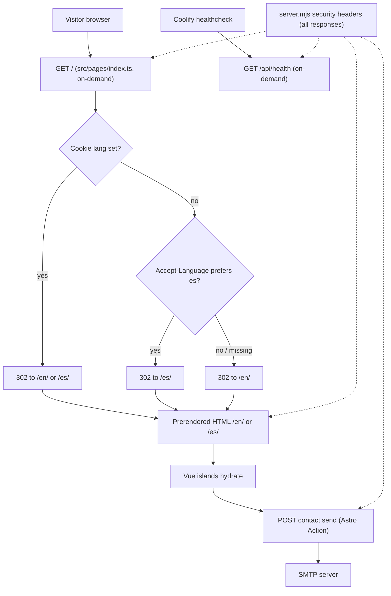
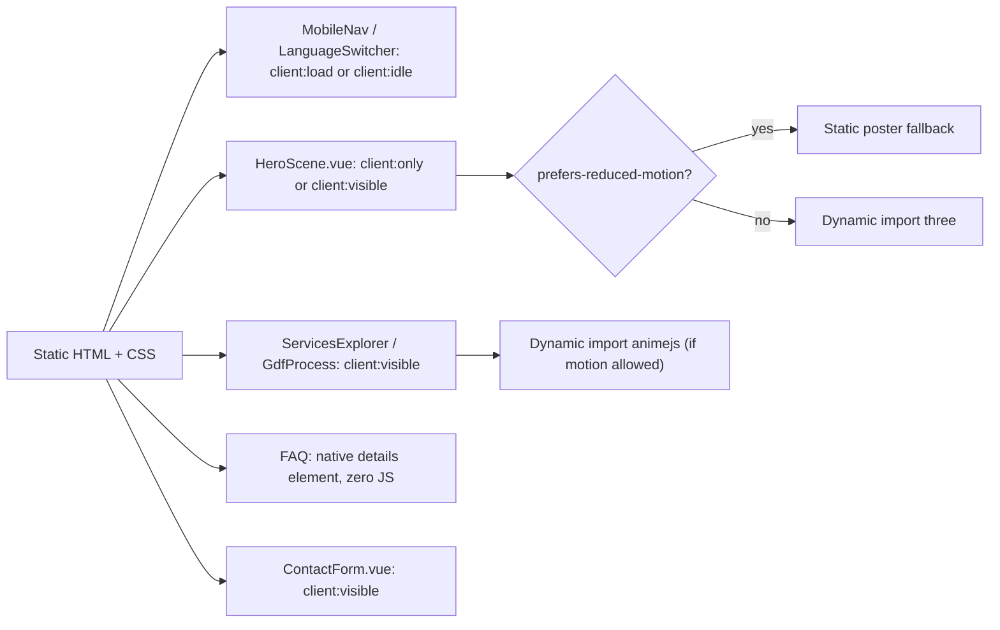
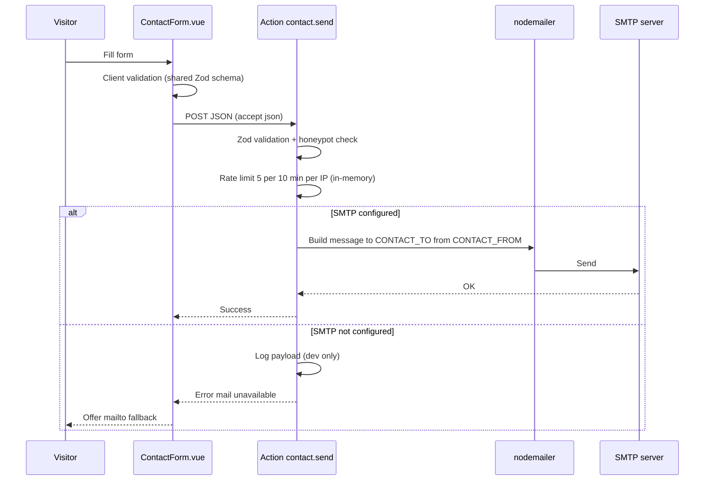

# Architecture — Godixy Technologies Landing Page

GDF phase F5 / gate G5 · Tier: Lite · Owner: Gabriel Núñez (Solution Architect)
Principle (GDF 5.2): architecture proportional to real needs. A bilingual marketing site with one contact form needs no database, no separate backend and no orchestration platform.

## 1. Context

- Public, bilingual (EN/ES) landing page for Godixy Technologies.
- Mostly static content; interactivity limited to a few islands (3D hero, services explorer, GDF process, FAQ, contact form, language switcher, mobile nav).
- One server-side capability: sending contact messages via SMTP.
- Single Node container on Coolify. No persistence, no authentication, no third-party APIs beyond SMTP.

## 2. Stack

| Layer | Choice |
| --- | --- |
| Framework | Astro 7 (7.3.x), `output: 'static'` + `@astrojs/node` (`mode: 'standalone'`) wrapped by `server.mjs` |
| Islands | Vue 3 via `@astrojs/vue` |
| i18n | Astro i18n routing + typed TS dictionaries |
| Server logic | Astro Actions (`contact.send`), `astro:env` secrets, nodemailer |
| Motion | Three.js + anime.js v4, lazy-loaded |
| Runtime | Node 22 alpine, Docker multi-stage, Coolify |

## 3. Request flow



Prerendered pages: `src/pages/[lang]/index.astro` via `getStaticPaths` for `en` and `es`. i18n config: `locales: ['en','es']`, `defaultLocale: 'en'`, `prefixDefaultLocale: true`, `redirectToDefaultLocale: false` (root redirect is owned by `index.ts`).

## 4. Island hydration



Everything not listed as an island is static `.astro` and ships zero JS. Exact directive per island is set at implementation; the rule is "latest hydration that preserves UX".

## 5. Module boundaries

```text
src/
├── pages/            index.ts (redirect), [lang]/index.astro, api/health.ts
├── layouts/          BaseLayout.astro (head, SEO, hreflang, lang attr)
├── actions/index.ts  registers contact.send (same-origin check, IP key, error mapping)
├── features/
│   ├── hero/ services/ process/ audience/ about/ engagement/ faq/ navigation/
│   └── contact/      ContactForm.vue, schema.ts (Zod, shared client/server)
└── shared/
    ├── i18n/         en.ts, es.ts (typed against en), utils.ts
    ├── ui/           presentational primitives
    ├── motion/       lazy loaders + reduced-motion helpers
    └── styles/       tokens, global CSS
```

Rules:
- `features/*` may import `shared/*`; features do not import each other (composition happens in pages/layouts).
- `shared/*` never imports `features/*`.
- Islands receive translated strings as props from `.astro` parents; dictionaries are not bundled whole into client JS.
- Only `actions/`, `pages/index.ts` and `pages/api/*` run on the server at request time; `server.mjs` (repo root) is the process entry point.
- `features/contact/server/*` is server-only and dependency-injected (`handle-contact.ts`) so it is unit-testable without Astro virtual modules; only `mailer.ts` touches `astro:env`.
- Exception to "features do not import each other": `services` imports `contact/service-intent.ts`, a tiny event/sessionStorage contract that preselects a service in the form.

## 6. Contact data flow



- Secrets via `astro:env` server schema: `SMTP_HOST`, `SMTP_PORT`, `SMTP_USER`, `SMTP_PASS`, `CONTACT_TO` (default `hello@godixy.com`), `CONTACT_FROM`.
- No storage of submissions. Data exists only in transit and in the recipient mailbox.
- Rate limit state is per process and resets on restart; acceptable for a single container (see ADR-003).

## 7. Security strategy (summary)

- CSP: Astro `security.csp` emits a hash-based `<meta>` policy in every prerendered page (`script-src`/`style-src` hashes, `default-src 'self'`, no CDNs). Consequence: no server-rendered `style="..."` attributes (Vue `v-show`/`:style` are avoided; dynamic values are set through the CSSOM).
- HTTP headers (`server.mjs`, applied to static and on-demand responses): `frame-ancestors 'none'`, `X-Frame-Options`, `nosniff`, `Referrer-Policy`, `Permissions-Policy`, COOP, and HSTS when `ENABLE_HSTS=true`. Astro middleware was rejected because it does not run for prerendered files.
- CSRF: Astro `checkOrigin` covers form posts; the JSON action additionally rejects a mismatching `Origin`.
- Input: server-side Zod validation is authoritative; client validation is UX only. Header injection prevented by never placing raw user input in mail headers other than a validated `replyTo`.
- Abuse: honeypot (silent success) + per-IP rate limit. Behind Coolify's proxy set `TRUST_PROXY=true` so the first `X-Forwarded-For` entry is used; otherwise the socket address is used.
- Secrets only in Coolify env, never in repo or client bundle (`astro:env` server `access: 'secret'`).
- Errors returned to the client are generic; details stay in server logs.
- Security review owner: Nicolás Vega.

## 8. Test strategy

| Level | Tool | Scope |
| --- | --- | --- |
| Static | TypeScript strict, `astro check`, ESLint | Types, EN/ES dictionary parity (compile-checked) |
| Unit | Vitest | `schema.ts`, i18n utils, locale negotiation, rate limiter, mail-unavailable branch |
| E2E | Playwright | Root redirect (cookie, Accept-Language, default), both locales render, language switch, form success / validation / fallback, reduced-motion fallback, `/api/health` |
| Non-functional | Lighthouse / axe (via Playwright) | Performance, accessibility, SEO per locale |

QA evidence owner: Isabel Medina.

## 9. Deployment summary

- Docker multi-stage: build stage (`npm ci`, `astro build`) → runtime stage Node 22 alpine running `node server.mjs` (imports `dist/server/entry.mjs` with autostart disabled).
- Env: `HOST=0.0.0.0`, `PORT=4321`, plus SMTP/contact secrets.
- Healthcheck: `GET /api/health` (on-demand endpoint).
- Platform: Coolify (TLS and reverse proxy handled by Coolify). Single instance.
- Rollback/backup/recovery content owner: Paula Castillo.

## 10. Decisions

- [ADR-001](adr/ADR-001-astro-islands-with-vue.md) Astro islands with Vue 3
- [ADR-002](adr/ADR-002-i18n-routing.md) i18n routing and typed dictionaries
- [ADR-003](adr/ADR-003-astro-actions-node-adapter.md) Astro Actions on the Node adapter
- [ADR-004](adr/ADR-004-motion-threejs-animejs.md) Motion with Three.js and anime.js
